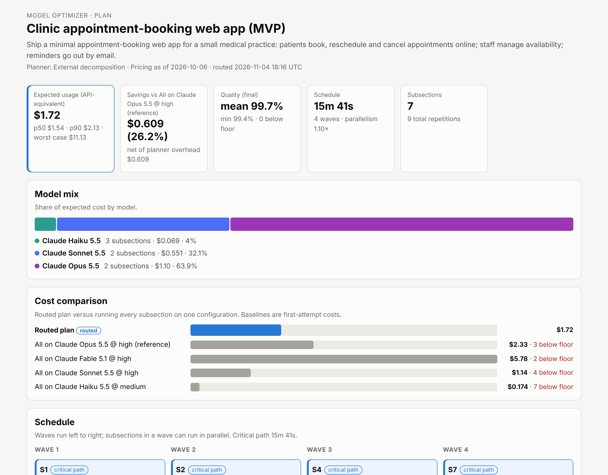

# model-optimizer

model-optimizer is a Claude Code plugin and command-line tool (`mopt`). It breaks any task, project or plan into subsections and runs each one on the Claude model and effort level that delivers a verified quality floor at the lowest usage. The floor is 99% by default, rising to 99.5% for critical or mechanically checkable work.

Every subsection gets four things:
- a precise brief;
- explicit interfaces to the rest of the plan;
- an independent verification step, using two reviewers on different models where the stakes call for it;
- an escalation ladder, so no subsection is ever accepted with a known failure.

Outcomes are logged, so the routing calibrates itself to your real work.

On the bundled example, a seven-part clinic booking app run as Claude Code subagents, the routed plan meets every floor (mean 99.7%, minimum 99.4%) at about $1.72 of API-equivalent usage. The cheapest way to hit the same floors with a single model is Opus 5.5 at extra-high effort, at $3.55, so routing uses 52% less. Running everything on one model without verification misses the floor even when the model is the strongest available:

| Single model | API-equivalent usage | Subsections below the floor |
| --- | --- | --- |
| Opus 5.5 at high | $2.33 | 3 |
| Sonnet 5.5 at high | $1.14 | 4 |
| Fable 5.1 at high | $5.78 | 2 |



## Install in Claude Code

```
/plugin install model-optimizer --marketplace Luca021123/model-optimizer
```

On Claude Code versions before 2.1.275, add the marketplace first, then install:

```
/plugin marketplace add Luca021123/model-optimizer
```

```
/plugin install model-optimizer@model-optimizer
```

The plugin works without an API key or `npm install`. It adds four things:
- the `optimize` skill;
- a `mopt-worker` subagent, which does one subsection;
- a `mopt-reviewer` subagent, which can read files and run checks but never edits;
- the `mopt` command, which is on Claude's PATH while the plugin is enabled.

Run `/model-optimizer:optimize <task or plan file>`, or ask Claude to optimize, route or break down a multi-part task.

## What happens when you optimize a task

1. **Decompose.** Claude writes the decomposition, judging the work against the scoring rubric (`mopt rubric`). That means deciding what the parts are, how they connect, and scoring each part on six difficulty signals and two risk signals. Claude does not choose models.
2. **Route.** `mopt route` makes every model, effort, verification and escalation decision deterministically, and writes a dispatch sheet.
3. **Dispatch.** Claude launches each wave of subagents in parallel, passing the assigned `model` and `effort` on every Agent call.
4. **Verify.** Reviewer subagents check each result before anything builds on it. A failure is re-dispatched one rung up the ladder with the reviewer's feedback, and an exhausted ladder stops that branch and reports it.
5. **Log.** `mopt log` records every attempt, with the token count and duration Claude Code reports for the subagent, so the next plan routes better.

## How the routing decides

Each subsection's six difficulty signals combine into a required capability level, weighted towards the hardest single dimension. Each model at each effort level has a capability ceiling: the difficulty at which its first attempt succeeds about 90% of the time. A logistic curve turns the gap between the two into a success probability.

Under the default `max` preset, a configuration qualifies for a subsection only if it passes two tests:
- its first attempt succeeds at least 90% of the time, so the plan never budgets on a model that will probably fail;
- after verification and escalation, the probability of a correct result reaches the floor.

Among the configurations that qualify, the router picks the one with the lowest expected usage per completed subsection. That figure counts the first attempt, the reviews, and each escalation weighted by its probability. A cheap model that needs retries is never mistaken for a cheap result.

"100% wherever we can" is built into verification rather than promised by any single model. Under `max`, every output is verified:
- Mechanically checkable work must pass its tests, type-checks or schema validation, plus a reviewer.
- Critical work, or work that is hard to check, gets two independent reviewers on different models, and both must pass.
- Criticality-5 work also needs your sign-off.

The decomposition step asks for mechanically checkable acceptance criteria wherever possible, because checkable work is what can be pushed closest to 100%. The `balanced` (95%) and `economy` (90%) presets relax all of this when you choose to.

Two more checks keep the plan honest:
- **One model is often enough:** if routing would save less than 10% compared with the cheapest single configuration that meets every floor, the router recommends using that single model instead.
- **Median and tail cost:** a Monte Carlo pass over the escalation ladders reports the median and 90th-percentile usage alongside the average.

## Usage on a subscription

Claude Code subagents do not make one API call each. They run loops of tool steps, re-reading their context at every step, mostly from the prompt cache. The default `agent` mode models those loops, setting the number of steps from the subsection's horizon signal. This puts the estimates in the same range as real subagent runs. `mopt log --total-tokens` then corrects them per model from your own runs.

Anthropic does not publish how fast each model draws down subscription limits, so `mopt` reports usage at API prices as the best public proxy for relative consumption, and labels it API-equivalent. Claude Code's documentation does state that session and weekly limits are shared across all models, and that Opus and Sonnet each also have a family limit. Routing therefore helps in two ways: it lowers total usage, and it spreads work across families, so Haiku-suitable work does not draw on the Opus or Sonnet limits. `/usage` in Claude Code shows the real attribution, including each subagent's share.

## The command line

```bash
npm install          # only needed for development, API mode, or using the CLI outside the plugin
node bin/mopt.js route examples/decomposition.json --format dispatch --out .mopt/dispatch.md
node bin/mopt.js route examples/decomposition.json --mode api
node bin/mopt.js run .mopt/plans/clinic-appointment-booking-web-app-mvp.json --dry-run --dashboard
node bin/mopt.js stats
```

| Command | What it does |
| --- | --- |
| `mopt route <decomposition.json>` | Route a decomposition (or re-route a saved plan) without calling any API |
| `mopt plan <file \| - \| "text">` | Decompose with the API planner (needs a key), or `--offline` heuristics, then route |
| `mopt run <plan.json>` | Execute on the Claude API with verification, escalation, a `--budget` cap and live feedback |
| `mopt report <plan.json \| run.json>` | Render as `table`, `md`, `html`, `json` or `dispatch` |
| `mopt log` | Record an attempt's outcome (from subagents or any other execution) |
| `mopt stats` | Show what the outcome ledger has learned |
| `mopt models` / `mopt schema` / `mopt rubric` | Prices and priors, the decomposition JSON Schema, the scoring rubric |

Routing options include:
- `--mode agent|api`;
- `--quality max|balanced|economy`;
- `--models haiku,sonnet,opus` to restrict which models are allowed;
- `--baseline opus@high`;
- `--batch`, `--no-cache` and `--max-escalations`.

`mopt help <command>` lists everything.

### API mode

With an `ANTHROPIC_API_KEY`, `mopt plan` uses Claude Opus 5.5 as the planner, and `mopt run` executes the plan directly on the Messages API. It runs each wave in parallel, streams responses, and sets `output_config.effort` on each call. It caches the shared brief where that pays, and uses the server-side refusal fallback on models that support it. Reviewers return structured verdicts per criterion. Accepted artifacts flow into downstream prompts; failures escalate with feedback, and dependents of a failed subsection are skipped.

Under `max`, a reviewer that cannot run stops the subsection instead of letting unverified work through. The budget guard stops new attempts before the projected spend crosses `--budget`.

`--dashboard` serves a live browser view over Server-Sent Events (SSE); the terminal shows the same feed. `--dry-run` rehearses the whole run from the router's own estimates without calling the API. Every run writes its attempts, verdicts, artifacts, event log and a static HTML report to `.mopt/runs/`. The API path is tested through a scripted client, so rehearse with `--dry-run` and start real runs with a small `--budget`.

## Calibration

The capability ceilings, thinking-token multipliers, throughput figures and agent-loop sizes in `src/catalog.ts` and `src/estimate.ts` are priors, not benchmarks. The outcome ledger (`.mopt/ledger.jsonl`) recalibrates four things:
- for each category of work, the difficulty offset that makes predicted pass rates match observed ones;
- for each model and effort level, the ratio of thinking to visible output;
- each model's input ratio and throughput;
- in agent mode, the ratio of real subagent tokens to the estimate.

Small samples are shrunk towards the prior. Prices are Anthropic first-party API rates as of 2026-10-06 (`mopt models`); override them, or the priors, with `--catalog file.json`.

## Development

```bash
npm install
npm run check        # type-check and the full node:test suite
npm run bundle       # rebuild the plugin's zero-install CLI (a test fails if it is stale)
npm run build        # compile to dist/ for the npm package
```

The source runs directly on Node 22.18 or later, which strips TypeScript types natively. The plugin ships `plugins/model-optimizer/lib/mopt.mjs`, an esbuild bundle with zod inlined. The Anthropic SDK is loaded only when API mode is used, which is why the plugin needs no install.

The source is organised as follows:

| Path | Contents |
| --- | --- |
| `src/types.ts`, `src/catalog.ts`, `src/rubric.ts` | Data contracts, prices and priors, scoring anchors |
| `src/scoring.ts`, `src/estimate.ts`, `src/router.ts` | Difficulty, success and quality-floor model; agent- and API-mode cost models; routing policy |
| `src/dag.ts`, `src/metrics.ts`, `src/simulate.ts` | Interface checks and schedule; plan metrics; cost distribution |
| `src/planner/` | API and offline planners |
| `src/prompts.ts`, `src/executor/run.ts`, `src/llm.ts` | Briefs and review prompts; API executor; the only module that loads the SDK |
| `src/ledger.ts` | Calibration |
| `src/render/`, `src/server.ts` | Terminal, Markdown, dispatch and HTML views; the live dashboard |
| `plugins/model-optimizer/` | The Claude Code plugin |
| `.claude-plugin/marketplace.json` | The marketplace that lists it |
